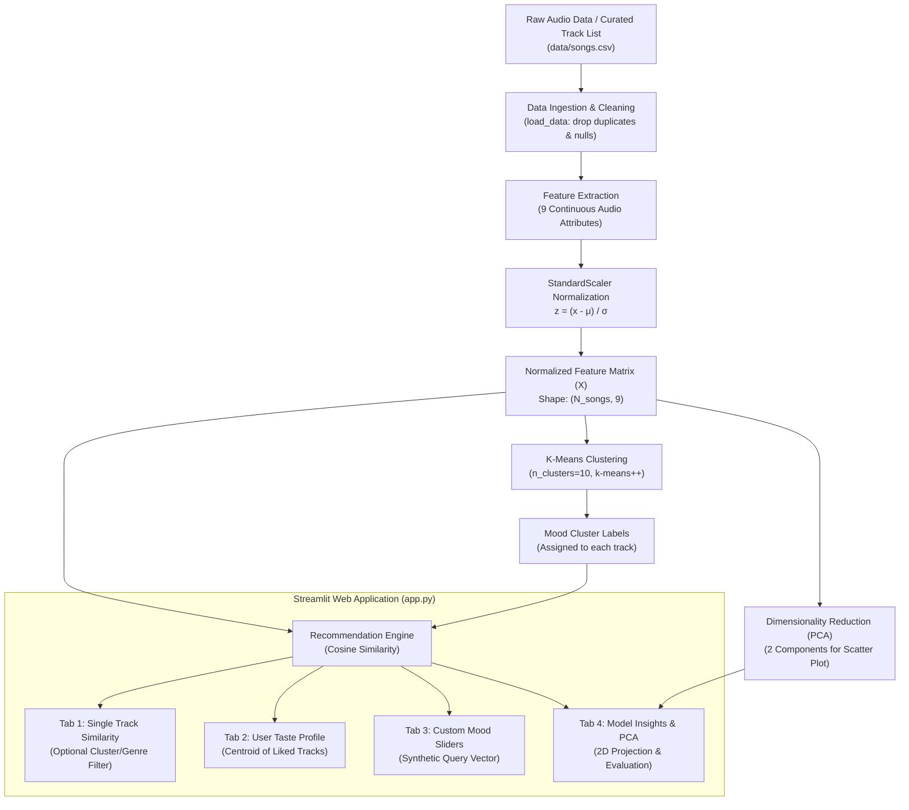

# Comprehensive Project Documentation: Content-Based Music Recommendation System

## 1. Project Overview & Executive Summary

The **Music Recommendation System** is an end-to-end Machine Learning mini-project designed to deliver personalized song recommendations using **content-based filtering**, **unsupervised clustering**, and **vector space similarity modeling**. 

Modern music platforms often struggle with the **cold-start problem**—recommending music to new users or recommending newly released tracks with zero user engagement history. Traditional collaborative filtering fails in these scenarios because it depends on historical user-item interactions (ratings, scrobbles, thumbs-up). This project addresses that challenge by analyzing songs based solely on their **intrinsic acoustic properties** (e.g., energy, danceability, acousticness, tempo, valence) extracted from audio signals.

### Key Objectives
* **Acoustic Profiling**: Represent each song as a standardized multi-dimensional feature vector.
* **Vector Similarity Ranking**: Implement Cosine Similarity to find nearest musical neighbors for single songs or composite multi-song user taste profiles.
* **Latent Mood Discovery**: Group tracks into acoustic archetypes using K-Means clustering.
* **Interactive Exploration**: Provide a full-featured Streamlit web application with dynamic sliders, taste aggregation, and interactive 2D PCA projections.
* **Empirical Evaluation**: Evaluate acoustic-to-genre coherence using Precision@K and Cluster Purity.

---

## 2. System Architecture & Workflow Pipeline



### Data Flow Stages
1. **Ingestion & Validation**: Loading tabular music data, dropping nulls, and eliminating duplicate track names.
2. **Standardization**: Scaling all 9 continuous acoustic features into uniform standard normal distributions ($\mu = 0, \sigma = 1$).
3. **Cluster Modeling**: Fitting a $K$-Means clustering algorithm on the standardized feature matrix to group tracks into discrete mood/vibe bins.
4. **Vector Querying & Ranking**: Querying the matrix using Cosine Similarity for single songs, composite centroids, or synthetic user slider preferences.
5. **Dimensionality Reduction**: Transforming the 9-dimensional space into 2 principal components via PCA for intuitive visual exploration.

---

## 3. Dataset & Audio Feature Representation

The system utilizes 9 key audio descriptors inspired by the Spotify Web API acoustic analysis model:

| Feature | Scale / Range | Description | Impact on Musical Vibe |
| :--- | :--- | :--- | :--- |
| **`danceability`** | $0.0 \dots 1.0$ | How suitable a track is for dancing based on tempo, rhythm stability, beat strength, and regularity. | High = Club/Pop/Funk, Low = Classical/Ambient. |
| **`energy`** | $0.0 \dots 1.0$ | Perceptual measure of intensity, activity, loudness, timbre, and entropy. | High = Metal/EDM/Rock, Low = Acoustic/Lullaby. |
| **`loudness`** | Decibels (dB), typ. $-60 \dots 0$ | Overall loudness of a track averaged across the entire signal. | Distinguishes heavily mastered pop/metal from dynamic classical music. |
| **`speechiness`** | $0.0 \dots 1.0$ | Detects the presence of spoken words (rap, spoken word, podcasts). | High = Hip-Hop/Rap, Low = Instrumental/Melodic. |
| **`acousticness`** | $0.0 \dots 1.0$ | Confidence metric for whether the track is purely acoustic vs. synthesized/electric. | High = Folk/Classical, Low = Electronic/Synth-Pop. |
| **`instrumentalness`** | $0.0 \dots 1.0$ | Predicts whether a track contains no vocals ("ooh" and "aah" sounds treated as instrumental). | High = Classical/Techno/Ambient, Low = Pop/Vocal R&B. |
| **`liveness`** | $0.0 \dots 1.0$ | Detects audience presence in the recording (live concert setting). | $> 0.8$ strongly indicates a live performance. |
| **`valence`** | $0.0 \dots 1.0$ | Musical positiveness/cheerfulness conveyed by the track. | High = Happy/Euphoric/Cheerful, Low = Sad/Depressed/Angry. |
| **`tempo`** | Beats Per Minute (BPM), $\sim 50 \dots 220$ | Overall estimated pace/speed of the track. | Drives the rhythmic pacing and physical energy. |

> [!NOTE]
> **Genre is deliberately omitted from the feature matrix.** The recommendation engine operates completely unsupervised on audio features alone. Genre is only used downstream as a post-filter option in the UI and as a ground-truth proxy for quantitative evaluation.

---

## 4. Algorithms & Mathematical Foundations

### 4.1 Feature Normalization: `StandardScaler`

#### The Problem
The features exist on radically different scales:
* `tempo` ranges from $60$ to $220+$ BPM.
* `loudness` ranges from $-25$ to $0$ dB.
* Features like `danceability` and `energy` are bounded strictly between $0.0$ and $1.0$.

If unscaled data were fed into Euclidean distance or Cosine similarity calculations, a difference of $50$ BPM in tempo would dwarf a massive difference of $0.5$ in danceability or valence.

#### Mathematical Formulation
Each feature vector $x_j$ across the dataset is standardized using $z$-score normalization:
$$z_{ij} = \frac{x_{ij} - \mu_j}{\sigma_j}$$

Where:
* $x_{ij}$ is the raw value of feature $j$ for song $i$.
* $\mu_j = \frac{1}{N}\sum_{i=1}^N x_{ij}$ is the mean of feature $j$.
* $\sigma_j = \sqrt{\frac{1}{N}\sum_{i=1}^N (x_{ij} - \mu_j)^2}$ is the standard deviation of feature $j$.

Result: All 9 features have $\mu = 0$ and $\sigma^2 = 1$, giving each acoustic property equal potential influence.

---

### 4.2 Recommendation Engine: Vector Space Modeling & Cosine Similarity

#### Why Cosine Similarity?
In high-dimensional feature spaces, cosine similarity measures the **cosine of the angle** between two vectors rather than their geometric distance. This captures the **relative ratio and profile of musical traits** (e.g., high energy + high valence + low acousticness) independent of overall vector magnitude.

#### Mathematical Formulation
Given a query vector $\vec{q} \in \mathbb{R}^9$ and a candidate song vector $\vec{x}_i \in \mathbb{R}^9$:

$$\text{similarity}(\vec{q}, \vec{x}_i) = \cos(\theta) = \frac{\vec{q} \cdot \vec{x}_i}{\|\vec{q}\|_2 \|\vec{x}_i\|_2} = \frac{\sum_{j=1}^9 q_j x_{ij}}{\sqrt{\sum_{j=1}^9 q_j^2} \sqrt{\sum_{j=1}^9 x_{ij}^2}}$$

The similarity score lies in the interval $[-1.0, 1.0]$, where $1.0$ indicates identical orientation in feature space.

#### Three Recommendation Modalities

```
1. Single Song Query:
   q = X[seed_index]
   Rank all x_i != q by CosineSimilarity(q, x_i)

2. User Taste Profile Centroid:
   q_profile = (1 / |Liked|) * SUM_{s in Liked} X[s]
   Rank all x_i not in Liked by CosineSimilarity(q_profile, x_i)

3. Synthetic Mood Slider:
   raw_prefs = {energy: 0.8, valence: 0.6, ... unspecified -> dataset_mean}
   q_synthetic = StandardScaler.transform(raw_prefs)
   Rank all x_i by CosineSimilarity(q_synthetic, x_i)
```

1. **Item-to-Item (Seed Track)**:
   * Finds songs closest to a specific target song.
   * Excludes the query song itself by masking its index ($\text{sim}[i] = -1$).
2. **Taste Profile Aggregation (Centroid Formulation)**:
   * When a user selects multiple favorite songs $L = \{s_1, s_2, \dots, s_m\}$, the system calculates the center of mass (centroid) in normalized feature space:
     $$\vec{p} = \frac{1}{|L|} \sum_{s \in L} \vec{X}_s$$
   * Tracks already in the user's liked set are excluded from recommendations.
3. **Custom Mood Slider Synthesizer**:
   * Generates a virtual query vector from user UI inputs.
   * For any unadjusted slider, the feature value defaults to the global empirical dataset mean $\bar{x}_j$.
   * The constructed raw vector is normalized using the pre-fitted `StandardScaler` before similarity ranking.

---

### 4.3 Unsupervised Mood Partitioning: $K$-Means Clustering

#### Objective
$K$-Means partitions the $N$ songs into $K$ distinct "mood clusters" $S = \{S_1, S_2, \dots, S_K\}$ based on acoustic similarity, without needing explicit genre or human labels.

#### Mathematical Optimization
The algorithm minimizes the Within-Cluster Sum of Squares (Inertia / WCSS):
$$\arg\min_{S} \sum_{k=1}^K \sum_{\vec{x} \in S_k} \|\vec{x} - \vec{\mu}_k\|_2^2$$

Where $\vec{\mu}_k = \frac{1}{|S_k|} \sum_{\vec{x} \in S_k} \vec{x}$ is the mean centroid of cluster $S_k$.

#### Implementation Details
* **Initialization**: Uses `k-means++` to spread out initial cluster centers, drastically reducing the probability of sub-optimal convergence.
* **Repetitions**: `n_init=10` runs with different centroid seeds to select the run with lowest inertia.
* **Role in UI**: Users can toggle `"Only songs from the same mood cluster"` in Tab 1, which guarantees that recommendations stay strictly within the same acoustic archetype even if a song in another cluster has a marginally higher cosine score.

---

### 4.4 Dimensionality Reduction: Principal Component Analysis (PCA)

#### Purpose
The audio feature space is 9-dimensional ($\mathbb{R}^9$), making direct human visualization impossible. Principal Component Analysis is applied to project the data into two orthogonal dimensions ($\mathbb{R}^2$) while preserving the maximum possible variance.

#### Mathematical Derivation
1. Center the standardized data matrix $X$ (already centered by `StandardScaler`).
2. Compute the empirical covariance matrix:
   $$\Sigma = \frac{1}{N - 1} X^T X$$
3. Perform Eigenvalue Decomposition (or Singular Value Decomposition $X = U \Sigma V^T$):
   $$\Sigma \vec{v}_k = \lambda_k \vec{v}_k$$
4. Select the top 2 eigenvectors $\vec{v}_1, \vec{v}_2$ corresponding to the two largest eigenvalues $\lambda_1, \lambda_2$.
5. Transform the original 9D points into 2D coordinates:
   $$\text{PC}_1 = X \vec{v}_1, \quad \text{PC}_2 = X \vec{v}_2$$

These 2 coordinates form the axes of the interactive Plotly scatter plot in the Streamlit UI, allowing users to visually inspect how clusters and genres group or overlap.

---

## 5. Evaluation Metrics & Analytical Discussion

Evaluating content-based recommendation systems is notoriously challenging without active user click-through logs. This project uses two quantitative proxy metrics:

### 5.1 Precision@K (Genre Match Proxy)

#### Formulation
Precision@$K$ measures the fraction of top-$K$ recommended songs that belong to the exact same genre as the query song:

$$\text{Precision@}K = \frac{1}{|Q|} \sum_{i \in Q} \frac{\sum_{r \in \text{Top-}K(i)} \mathbb{I}(\text{genre}(r) == \text{genre}(i))}{K}$$

Where $\mathbb{I}(\cdot)$ is the binary indicator function.

#### Why is Genre Precision@10 Modest (~28%–30%)?
On both real Spotify data and the curated 120-song dataset, Precision@10 typically falls around **28% - 30%**. This is **not a bug or algorithmic failure**, but an accurate reflection of musical reality:
1. **Genre is a Cultural Label, Not an Acoustic Boundary**: High-tempo, aggressive Pop songs (e.g., The Weeknd's *"Blinding Lights"*, 171 BPM, high energy) share audio feature space with energetic Rock and Metal songs (*"Mr. Brightside"*, *"Master of Puppets"*).
2. **Intra-Genre Diversity**: A melancholy acoustic ballad by Adele and an upbeat dance song by Dua Lipa are both categorized as "Pop", but acoustically they are polar opposites. A content recommender correctly matches Adele with Folk/Acoustic ballads rather than dance-pop.
3. **Cross-Genre Serendipity**: In music discovery, discovering an energetic Rock track when listening to an energetic Pop track is often a desirable recommendation, which strict genre precision penalizes as an "error".

---

### 5.2 Cluster Purity

#### Formulation
Cluster purity evaluates how homogeneous the $K$-Means clusters are with respect to ground-truth genre classes:

$$\text{Purity}(\Omega, \mathbb{C}) = \frac{1}{N} \sum_{k=1}^K \max_{j} |\omega_k \cap c_j|$$

Where:
* $\Omega = \{\omega_1, \omega_2, \dots, \omega_K\}$ is the set of $K$-Means clusters.
* $\mathbb{C} = \{c_1, c_2, \dots, c_J\}$ is the set of ground-truth genres.
* For each cluster $\omega_k$, we find the count of songs belonging to its most frequent genre $\max_j |\omega_k \cap c_j|$, sum these across all clusters, and divide by the total number of songs $N$.

Purity ranges from $\frac{1}{|\mathbb{C}|}$ (random dispersion) to $1.0$ (perfect separation). The project achieves **~41.7%** cluster purity across 10 genres, demonstrating strong acoustic clustering while reflecting natural cross-genre acoustic overlap.

---

## 6. Streamlit Web Application Interface

The project includes an interactive web interface built with **Streamlit** (`app.py`), structured into four functional tabs:

```
+-----------------------------------------------------------------------+
| 🎵 Music Recommendation System                                       |
| Content-based filtering: StandardScaler + Cosine Similarity + KMeans  |
+-----------------------------------------------------------------------+
| [Similar songs]  [My taste profile]  [Mood sliders]  [Model insights] |
+-----------------------------------------------------------------------+
```

### Tab Breakdown

| Tab | Purpose | Key User Controls | Behind the Scenes |
| :--- | :--- | :--- | :--- |
| **1. Similar songs** | Find nearest neighbors to any selected track | Song selector, $K$ slider (5–20), Genre filter dropdown, "Only same mood cluster" checkbox | Extracts $X[\text{song}]$, calculates cosine similarity vector, filters by cluster/genre mask, returns top $K$. |
| **2. My taste profile** | Recommend music based on an aggregated set of favorites | Multi-select song picker, $K$ slider, Genre filter | Averages the standardized vectors of chosen songs to compute the taste centroid $\vec{p}$, then ranks unseen songs. |
| **3. Mood sliders** | Generate song matches from desired mood/acoustic traits | Sliders for Energy, Danceability, Valence, Acousticness, Instrumentalness, Tempo | Assembles custom dictionary, fills missing with column means, transforms via `scaler`, and performs vector search. |
| **4. Model insights** | Statistical evaluation & visual exploration | Metric cards for Precision@10 & Cluster Purity; Radio button for PCA coloring | Runs 2-component PCA on $X$, plots 2D scatter plot colored by `genre` or `cluster` via Plotly Express; displays genre feature means table. |

---

## 7. Codebase Structure & File Inventory

```
ml-mini-new/
│
├── data/
│   └── songs.csv              # Primary curated dataset (120 tracks across 10 genres)
│
├── generate_data.py           # Dataset generator with curated real tracks & derived features
├── recommender.py             # Core ML module (preprocessing, KMeans, cosine ranking, metrics)
├── app.py                     # Streamlit multi-tab web application with Plotly visualizations
├── requirements.txt           # Python dependencies (scikit-learn, streamlit, pandas, plotly, etc.)
├── README.md                  # Quickstart guide and overview
├── PROJECT_DOCUMENTATION.md   # Full project technical and mathematical documentation
└── ml-mini-new.csv            # Extended synthetic reference dataset (1,230 tracks)
```

### File-by-File Responsibilities
* **`recommender.py`**:
  * `MusicRecommender`: Primary class handling `StandardScaler`, `KMeans`, indexing, vector ranking, and evaluation metrics (`precision_at_k`, `cluster_purity`).
  * `load_data()`: Reads CSV, validates required feature schema, removes duplicates and missing records.
* **`generate_data.py`**:
  * Contains a curated dictionary of 120 famous songs across 10 genres (Pop, Rock, Hip-Hop, Classical, Jazz, Electronic, Folk, Bollywood, Metal, R&B).
  * Synthesizes derived features (`loudness` in dB derived from energy and acousticness; `liveness` sampled from normal distribution).
* **`app.py`**:
  * Implements the Streamlit frontend with responsive caching (`@st.cache_resource`).
  * Integrates Plotly 2D PCA scatter plots with interactive hover tooltips showing track name, artist, and genre.

---

## 8. Setup, Installation & Execution

### Prerequisites
* Python 3.9+ (Python 3.10–3.13 supported)
* Virtual environment (recommended)

### Installation
```bash
# 1. Clone or navigate to the project directory
cd ml-mini-new

# 2. Install required packages
pip install -r requirements.txt
```

### Execution Steps
```bash
# Step A: (Optional) Rebuild the 120-song curated dataset
python generate_data.py

# Step B: Run the standalone CLI recommender test and evaluation metrics
python recommender.py

# Step C: Launch the Streamlit interactive dashboard
streamlit run app.py
```
Once launched, open your browser at `http://localhost:8501`.

---

## 9. Potential Extensions & Future Enhancements

For future research or academic project extensions, the following improvements can be implemented:

1. **Hybrid Filtering (Collaborative + Content)**:
   * Combine acoustic cosine similarity with matrix factorization (TruncatedSVD / LightFM) on user listening logs to leverage collective user habits.
2. **Optimal Cluster Selection via Elbow / Silhouette Analysis**:
   * Replace the fixed $K=10$ with automated silhouette score optimization to determine the ideal number of natural acoustic clusters.
3. **Alternative Metric Comparisons**:
   * Implement and benchmark alternative distance metrics: Euclidean distance, Manhattan distance, and Mahalanobis distance (which accounts for feature covariance).
4. **Spotify Web API Real-Time Integration**:
   * Fetch 30-second audio preview MP3s and high-resolution album cover art directly using Spotify's REST API.
5. **Intra-List Diversity Metric**:
   * Measure recommendation diversity using average pairwise distance among the top-$K$ recommendations to prevent filter bubbles.
